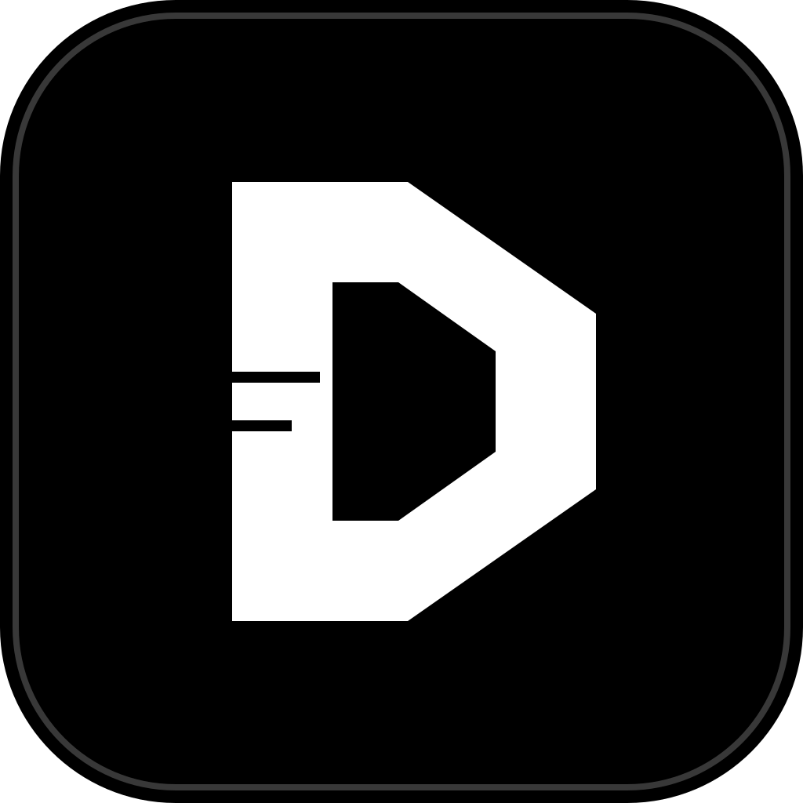

<p align="center">
  
</p>

<h1 align="center">Discorust</h1>

<p align="center">
  <strong>A monochrome, cyberpunk-flavoured Discord client written in Rust.</strong>
</p>

<p align="center">
  Native <a href="https://github.com/emilk/egui">egui</a> + <a href="https://wgpu.rs">wgpu</a> desktop client for existing Discord accounts.
</p>

---

> [!WARNING]
> **Unofficial and not endorsed by Discord.**
> Discorust talks to Discord's public gateway and REST endpoints using your existing account.
> Automating normal accounts outside the official OAuth2/bot API violates Discord's Terms of
> Service and carries a risk of account termination. This is a personal project; use it at your
> own risk.

## What this is

Discorust is a personal fork of [Serein](https://github.com/ViceVerse-cz/Serein), rebuilt around
a black-and-white visual theme. It keeps Serein's native Rust core and adds the Discorust
branding:

- **Cyber theme** — pure black surfaces, white type and a white accent, no colour noise.
- **Letter-D mark** — window icon, tray icon and launcher entry all use the same monochrome `D`.
- **Discorust naming** — window title, tray title and desktop entry.
- **Quiet updates** — the client no longer shows “Update available” banners; updates live in
  Settings → Updates when you want them.

Everything else — voice, screen sharing, noise suppression, extensions, themes — comes from
Serein. See the [upstream README](https://github.com/ViceVerse-cz/Serein#readme) and the
[documentation](docs/) for the full feature set.

## Highlights inherited from Serein

- Native Rust/egui/wgpu rendering with low memory use.
- Voice calls, screen sharing and WebRTC noise suppression.
- Multiple accounts, themes, custom fonts and an extension SDK.
- Local-first caches with bounded storage.

## Build and run

Rust **1.98.1** is pinned via `rust-toolchain.toml`. You also need a C/C++ toolchain, CMake and
the platform libraries listed in [Platform Support](docs/platform-support.md). On Linux that
means ALSA headers, `pkg-config`, GTK 4, WebKitGTK 6.0, fontconfig and Vulkan drivers.

```sh
git clone https://github.com/dsahduashdui/Discorust.git
cd Discorust
cargo build --release --locked
./target/release/serein
```

For a quick offline tour, run the synthetic demo instead:

```sh
cargo run --locked --features demo -- --demo
```

Source builds keep their data in `~/.local/share/serein-development`, isolated from an installed
Serein. The internal binary name, app ID and credential-store service remain `serein` /
`cz.viceverse.serein` on purpose, so existing sessions and saved logins keep working.

## Theme

Pick **Settings → Appearance → Cyber** to get the monochrome palette. The theme is stored per
profile and survives restarts.

## Credits and licence

Discorust is based on [Serein](https://github.com/ViceVerse-cz/Serein) by the Serein
contributors. Icon artwork derives from Phosphor Icons (MIT) and Simple Icons (CC0); see
[`assets/icons/README.md`](assets/icons/README.md) for provenance.

Licensed under either of [MIT](LICENSE-MIT) or [Apache-2.0](LICENSE-APACHE), at your option.
